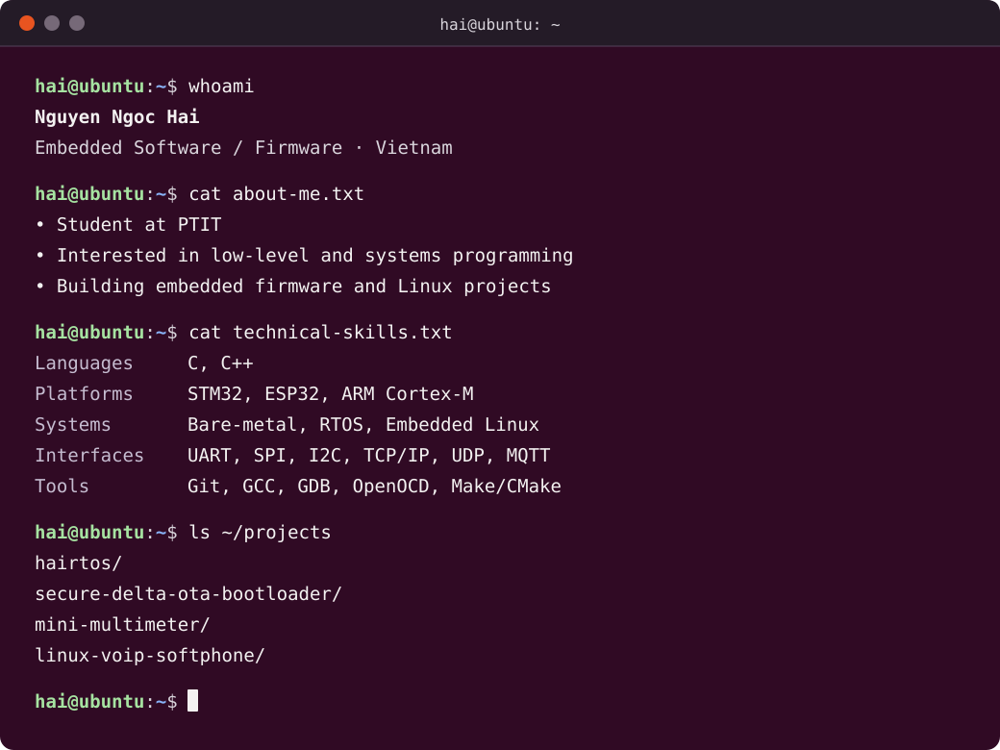

  

### Selected Projects

- **[hairtos](https://github.com/haikevins/hairtos)** — A preemptive RTOS for ARM Cortex-M, featuring task scheduling, synchronization, IPC, software timers, and an event-driven framework.
- **[Secure Delta OTA Bootloader](https://github.com/haikevins/secure-delta-ota-bootloader)** — Authenticated full and delta firmware updates for STM32 and ESP32, with resumable staging, rollback, and recovery.
- **[Mini Multimeter](https://github.com/haikevins/mini-multimeter)** — Bare-metal STM32 firmware for resistance, capacitance, PWM measurement and generation, with an I2C LCD interface.
- **[Linux VoIP Softphone](https://github.com/haikevins/linux-voip-softphone)** — A C++20/Linux SIP softphone using PJSUA2, Qt/QML, and RTP audio, with automated testing and diagnostics.

### Connect

[LinkedIn](https://www.linkedin.com/in/nguyengochai2004/) · [GitHub](https://github.com/haikevins)
